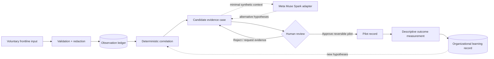

# FloorTruth v0.1 — Reference architecture

**Status:** original proposed design, pre-hackathon | **Scope:** synthetic demonstration | **Owner:** Recursion Lab

## Problem boundary

Organizations routinely capture surveys, incident reports, assistance requests, and employee feedback, yet those streams are often segregated by department and business workflow. The hypothesis to test is whether a provenance-preserving, governed correlation-to-outcome loop improves the **quality and speed of operational learning**. This is a research hypothesis, not an established performance claim.

**Non-goals:** replacing HR or safety escalation; rating employees; autonomous workforce decisions; scanning private enterprise networks; inferring proprietary third-party APIs; replicating another employer's product; determining regulatory compliance automatically.

## Context and logical data flow



**Critical separation:** the language model can propose explanations; deterministic code enforces decision transitions and calculates measurable outputs. Neither a model's answer nor a source citation is automatically proof of applicability or causality.

## Four architectural planes

### 1. Experience plane

Mobile-first employee capture; evidence-case review; experiment worksheet; accessible reporting. UI complexity is role-shaped. Employees do not need to understand model selection or prompt engineering to provide valuable observations.

### 2. Evidence plane

`Observation` → `EvidenceLink` → `CandidateCase` → `Hypothesis`. A case contains `evidence_ids`, report counts, distinct shifts, and known missing evidence. A model must not silently fabricate new evidence IDs. Future versions need consent metadata, source applicability, versioned transformations, and evidence expiry.

### 3. Decision/governance plane

`proposed → awaiting_review → approved|rejected → running → measured → closed|rolled_back`. The v0.1 demo implements *awaiting_review → pilot approved → measured* in memory; the full state machine is **planned**, not finished. Production permissions must be enforced in the API and database and verified independently from model behavior.

### 4. Learning/impact plane

Track descriptive values and a separate confidence/evidence status. Baseline comparability, seasonal effects, workforce shifts, and concurrent changes must be considered before treating measured differences as causal gains. Promote an intervention as an organizational standard only after human review of safety and evidence.

## Record contracts

```text
Observation { id, recorded_at, synthetic, source_channel, shift, area, text, topic,
              consent_version?, sensitivity?, source_ref? }
Case { id, evidence_ids[], corroboration, hypotheses[], missing_evidence[], status }
Hypothesis { claim, supporting_evidence_ids[], disconfirming_test, status: UNVERIFIED }
Decision { id, case_id, reviewer_role, decision, rationale, timestamp, audit_ref }
Experiment { id, case_id, intervention, comparator, time_window, assumptions,
             observed_metrics, known_confounders, decision_state }
Learning { case_id, finding, applicability_scope, source_lineage, expiration, review_status }
```

Fields marked `?` are planned in the target architecture, not present in the initial backend.

## Evaluation of the synthetic example

Four observations about shift handoff and equipment readiness are correlated into `CASE-HANDOFF`. The model may propose two explanations: unclear handoff responsibilities or recurring equipment faults. Neither is established from text alone. A human can approve a **demo** experiment. Illustrative baseline `34 minutes/shift` versus observed `22 minutes/shift`, for `40 shifts`, assumed burden `$35/hour`, intervention cost `$120` yields:

- Difference: `(34 − 22) × 40 = 480 minutes`
- Estimated gross labor-equivalent value: `480 ÷ 60 × $35 = $280`
- Estimated net: `$280 − $120 = $160`
- This is a **synthetic descriptive estimate**, not a validated ROI claim or evidence that a given cause was responsible.

For a real pilot, add an operational comparator and pre-defined safety and stop criteria. Avoid attributing changes to the intervention without plausible design and sensitivity analysis.

## Meta adapter

Implemented: `app/meta_adapter.py`, direct documented Meta Chat Completions endpoint. Constraints:
- Disabled by default; key loaded from server environment.
- Limited model allowlist; no model-key exposure to browser.
- Only preseeded or explicitly synthetic data eligible for transfer in this scaffold.
- Hardcoded instruction to propose *competing hypotheses, falsifiers, and missing evidence*.
- Model suggestions are informational; action gate remains deterministic.
- Basic error fallbacks. No authentication, rate-limiting, schema validation of model outputs, or production prompt-injection defense yet.

Future: structured JSON schema, provenance checker, model comparison (Muse Spark/open weights), per-call evaluation, retention policy, data minimization and cost instrumentation. Before connecting live data, complete a data-flow impact assessment and engineering security review.

## Interfaces

| Endpoint | Mode | Description |
|---|---|---|
| `GET /api/dashboard` | Read | Synthetic overview and KPI counts |
| `GET /api/signals` | Read | Synthetic observation ledger |
| `POST /api/signals` | Mutation | Add an invented observation |
| `GET /api/cases` | Read | Rule-based topic grouping and provenance |
| `GET /api/cases/{id}` | Read | Inspect hypothesis/evidence state |
| `POST /api/cases/{id}/approve` | Mutation | Record simulated human review |
| `POST /api/cases/{id}/measure` | Mutation | Model descriptive outcome **after approval** |
| `POST /api/cases/{id}/ai` | External, opt-in | Advisory Meta API call (if enabled) |

## Threat model / boundary conditions

| Risk | v0.1 treatment | Production requirement |
|---|---|---|
| Worker surveillance | No named employees, no scoring | Enforced anti-profiling policy, aggregation thresholds |
| Sensitive data leakage | Synthetic-only mode and basic redaction | Robust PII filters, policies, consent, DLP, retention and deletion |
| Wrong policy scope | No policy retrieval in MVP | Applicability metadata by role/location/effective date |
| Hallucinated findings | Hypothesis wording and source IDs | Automated grounding tests, reviewer disposition |
| Prompt injection | Fixed instruction context, bounded evidence | Segregated trust boundaries, tool policy, adversarial evals |
| Unauthorized actions | Demo-only approval, no live integrations | AuthN/AuthZ, signed audit, approval and rollback policies |
| Data-loss/UI rollback | In-memory demo intentionally nonpersistent | Transactional event store, idempotency, resumable state |
| ROI inflation | Explicit assumptions and causal caution | Contemporaneous controls, uncertainty intervals, sensitivity audit |

## Observed versus hypothesized versus planned

The conceptual design draws on generic enterprise patterns observed through legitimate employee-facing user experience and publicly available technology documentation. **No third-party internal topology or control implementation has been verified or copied.** Amazon product/function names are not part of the FloorTruth architecture or code. The reusable abstraction is the separation of employee front door, authorized enterprise workflows, evidence validation, and human-approved learning.

## Definition of done for a safe demo

- [x] All demo records are fictional.
- [x] Repeatable clustering and explicit source IDs.
- [x] Multiple explanations, not one asserted cause.
- [x] Server-side human approval gate for demo measurement.
- [x] Transparent deterministic ROI arithmetic.
- [x] Optional documented Meta adapter behind env gate.
- [ ] Authenticated Meta adapter test with real hackathon credentials.
- [ ] Persisted signed audit and full state machine.
- [ ] Real-world evaluation/power analysis and safety review.
- [ ] Rule-verified, submission-eligible implementation after Oct 26.
