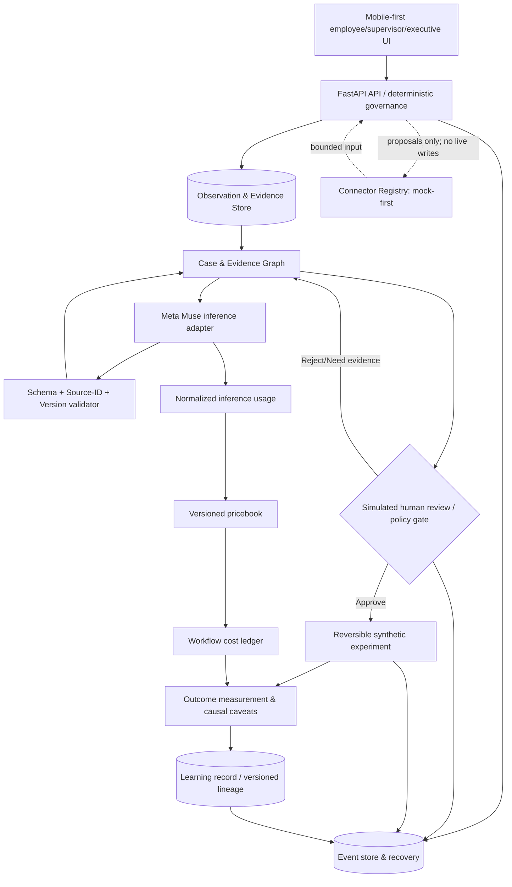

# FLOORTRUTH — MUSE BUILD HANDOFF
## Meta Global AI Developer Hackathon | Execution specification | 29 October 2026

**Document class:** Private working handoff for a coding agent, not the public hackathon submission.  
**Project:** FloorTruth / Recursion Lab  
**Status:** Existing **v0.2** executable baseline; **v0.3** governance/value layer SPECIFIED, NOT YET IMPLEMENTED.  
**Primary build objective:** Produce a judge-ready, Meta-powered, evidence-grounded, human-governed organizational learning demonstration—with an actual token/cost/value ledger and extensible API hooks—without disclosing private AIPP implementation IP.  
**Execution mode:** High-complexity, bounded, test-driven; work autonomously within the repository and return code, tests, screenshots and a change log. Do not pretend that unexecuted hooks are functional.

> **THE ONE-SENTENCE PRODUCT:** “The frontline knows. The enterprise forgets. FloorTruth closes the loop.”
>
> Employees report friction → AI correlates **evidence**, not people → humans review competing explanations → a reversible improvement experiment is authorized → the system distinguishes observed results from attributable value and records the inference cost of every AI step.

---

## 0. READ FIRST: HARD BUILD DIRECTIVES

1. **Inspect the existing repository before making architectural changes.** Do not blindly regenerate the application. This handoff accompanies `FloorTruth_Source_v0.2.zip`; its root is `floortruth-starter/`.
2. **Implement the public demonstrator, not the private governance engine.** Do not reconstruct proprietary AIPP passports, adaptive attribution algorithms, policy enforcement schemes, or unrelated Sentinel/J-Space private research. Build conventional, inspectable interfaces and calculations only.
3. **Keep all demo records invented.** No Amazon or other employer documents, screenshots, telemetry, workflow identifiers, employee records, real contractor names, or authenticated internal service calls. The transferable insight is architecture, not a copied implementation.
4. **Use Meta Model API Standard mode for project code and inference.** As of 29 October 2026, Meta says Contributor mode grants permission to use submitted prompts/code/files/responses in future model training. Muse Code subscription defaults may differ. Confirm the agent's current mode *before loading any private IP*. Never send unpublished AIPP code or secrets in prompts. See §15.
5. **Do not let model output authorize operations.** Model-generated explanations are proposals; business decisions, financial arithmetic, state transitions and budget decisions are enforced by deterministic application code.
6. **Ground every factual-looking claim.** Record `evidence_ids`, source versions, retrieval/observation timestamps, evidence status and explicit falsifiers. Schema compliance is not evidence validity.
7. **Make token-level economics visible, auditable and non-misleading.** Track actual provider-reported tokens where present; distinguish usage from estimated spend, promotional credits and monetary business benefit. Inference spend is a cost; not proof of token-attributable value.
8. **No speculative production integrations.** Create pluggable, typed adapter interfaces with mocks; keep external writes and credentials disabled. Only activate a live Meta endpoint when `MODEL_API_KEY` is present, Standard mode is confirmed and the synthetic-only setting passes.
9. **Limit unnecessary agent recursion.** Prefer one implementation pass plus independent test/evaluation, then repair. Avoid agent swarms, repetitious framework generation, and costly visual extras that do not strengthen the demonstration.
10. **Preserve working builds.** Commit logical milestones locally if Git is available; don't force push, publish code, deploy publicly, submit to judges, or alter external services without the owner's explicit approval.
11. **Check accepted participant rules.** The public event page still displays an outdated 'rules will be published' message. The actual participant/Discord terms govern prior scaffold reuse, eligibility, disclosure, submission deliverables and rights. Log what was checked. Do not stall local development pending an inaccessible rules page.
12. **Clearly label demo-only governance.** Current 'reviewer role' is user-supplied, not verified identity. Hash-linked SQLite events are not cryptographically signed or immutable. Never represent the scaffold as a secured production deployment.

**Priority order:** working vertical slice > accurate evidence and finance > dependable governance > clear UI > API-ready adapters > optional extras.

---

## 1. CONTEXT, ORIGINAL INTENT AND RESEARCH LINEAGE

### 1.1 Origin

FloorTruth arose from repeated firsthand enterprise observations that valuable operational knowledge is fragmented across organizational levels. A frontline employee, technician, scheduler or cleaner may identify a systemic defect before management dashboards do; a decision system can fail to capture, validate, route or learn from that knowledge. Prior research explored costly schedule interruptions in fabrication, production bottlenecks, cross-shift handoffs, organizational silos, and the gap between collecting employee feedback and producing independently verified improvements.

This is not a clone of any employer portal or an enterprise HR chatbot. Observing employee-facing systems such as AI assistance, feedback, learning, safety and issue escalation demonstrated the **general architectural possibility** of a unified front door. It did **not** establish how any employer's internal backend is constructed. We must not import screenshots or privileged source details into the submission.

### 1.2 Established project decision

A cross-functional **governed organizational learning layer** that sits conceptually above existing observation, operations, quality and improvement workflows. It is vendor-agnostic in its data contracts, but uses Meta's models as the hackathon inference implementation.

The learning loop is:

`CAPTURE → CLASSIFY/CORRELATE → EVIDENCE GRAPH → COMPETING HYPOTHESES → HUMAN REVIEW → REVERSIBLE EXPERIMENT → OBSERVE → EVALUATE → LEARNING / RETIREMENT`

A second parallel loop governs inference:

`REQUEST → BUDGET / SCOPE CHECK → PROVIDER CALL → PROVIDER USAGE → PRICEBOOK → LEDGER → WORKFLOW COST → VALUE EVALUATION`

These loops MUST link through case, experiment, inference and evidence IDs.

### 1.3 Research invariants to operationalize

| Invariant | Engineering implication |
|---|---|
| Evidence ≠ interpretation | Source records remain separate from hypotheses and model summaries |
| Authentic source ≠ applicable source | Future connector metadata supports role/site/version/scope checks; fail as 'unverified' otherwise |
| Correlation ≠ causation | Show descriptive effects; require controls/design to claim causal impact |
| Model advice ≠ authority | Every consequential transition is server-enforced and logged |
| Recursion value ≠ recursion depth | Bounded reasoning and test-driven iteration |
| Contextual salience ≠ research significance | Do not promote incidental chat or uncorroborated claims into durable organizational learning |
| Human optionality and recoverability | Manual fallback, reversible state, no silent irreversible operations |
| Provenance and divergence | Preserve contradictory signals, rejected hypotheses, evidence lineage and decision rationale |
| Cost transparency ≠ guaranteed ROI | Track spend and modeled benefits separately, with data-quality labels |

**Important:** Human–AI collaboration, J-Space and TDT inspired methods, but the public submission should not expose private implementations, formulas, original theory manuscripts or unpublished know-how.

---

## 2. VERIFIED V0.2 BASELINE — REUSE, DON'T REINVENT

The prior `FloorTruth_Source_v0.2.zip` was inspected for this handoff. Its relevant files:

```text
floortruth-starter/
  README.md
  run.py
  requirements.txt
  .env.example
  app/
    main.py                  # FastAPI, endpoints and demo request models
    domain.py                # deterministic topic grouping, redaction and cost estimates
    store.py                 # SQLite event history, replay, evidence fingerprints
    meta_adapter.py          # optional Muse Spark 1.3 JSON-schema Chat Completions
  web/
    index.html               # responsive static app
    app.js                   # browser UI and API consumption
    styles.css               # visual system
  tests/
    test_app.py
  docs/
    ARCHITECTURE.md
    DAY1_REVIEW.md
    META_ACTIVATION.md
    JUDGE_DEMO_v0.2.md
    EVALUATION.md
    HACKATHON_PLAN.md
    DEMO_SCRIPT.md
  assets/
    FloorTruth_Reference_Architecture.svg
```

**Implemented:** 9 fictional observations / 3 grouped cases; source IDs and competing hypotheses; synthetic review; evidence fingerprint (stale approvals rejected with HTTP 409); demo-only rollback; SQLite event replay; hash-chain integrity *check*; deterministic outcome estimate; optional Meta `muse-spark-1.3` server-side JSON schema adapter with local citation-ID validation. `tests/test_app.py` currently contains **13 test functions**; run the suite rather than relying on an earlier reported count.

**Not implemented in v0.2:** token-level cost and pricing ledger, per-workflow quotas, live Meta account test in this environment, actual auth, supplier connectors, durable model response records, measured causal effects, data privacy controls beyond rudimentary regex redaction, operational external actions, multi-provider routing and production security.

**Existing APIs (do not break them):**

```text
GET  /api/health
GET  /api/dashboard
GET  /api/signals
POST /api/signals
GET  /api/cases
GET  /api/cases/{case_id}
POST /api/cases/{case_id}/approve
POST /api/cases/{case_id}/measure
POST /api/cases/{case_id}/rollback
GET  /api/cases/{case_id}/timeline
GET  /api/audit/verify
POST /api/cases/{case_id}/ai
```

**Known debt:** The older `docs/ARCHITECTURE.md` has v0.1 implementation notes and is stale in places. Update documentation to reflect *verified* v0.3 behavior; do not copy outdated statements about missing persistence or grounding into the new README. Review current `app/store.py` before adding tables to avoid replay and transaction inconsistencies. The current `main.py` uses a global `DemoStore`; tests replace it via monkeypatch.

**Existing deterministic math sanity case:** 34 baseline minutes versus 22 observed minutes for 40 periods at $35/h implies 480 minutes, $280 estimated labor-equivalent gross value, $120 pilot cost, $160 modeled net, and 133.3% modeled ROI. **Not causal, not realized cash savings.** An inference ledger should add actual/estimated AI expense when appropriate, while preserving exact rounding policy.

---

## 3. HACKATHON POSITIONING AND JUDGING STRATEGY

- Event: Meta Global AI Developer Hackathon, October 26–November 4, 2026.
- Deadline: **November 4 at 9:00 PM US Eastern (7:00 PM Mountain)**. Verify event account for amendments.
- Primary theme: **Build for Your World** — operational intelligence from real domain knowledge, demonstrated with **synthetic** data.
- Secondary resonance: **Push the Frontier** — evidence-grounded multimodal reasoning, constrained governance and actionable organizational learning.
- Provisional track: **Indie developer**, unless actual participant entry requires startup/team selection. Indie judges emphasize creativity, technical ambition and whether it works. Startup judges emphasize execution and production soundness.

**The judge must understand within 20 seconds:** FloorTruth is not another anonymous suggestion box. It links observations to falsifiable evidence, human-governed decisions and measurable business results; its AI spend is accountable.

**Three-minute vertical slice:**
1. **Capture:** a synthetic night-shift voice/text observation about readiness; user sees consent/synthetic label.
2. **Correlate:** several fictional shifts produce one evidence case; competing AI hypotheses cite only real observation IDs.
3. **Challenge:** show missing evidence and a contradictory observation; new evidence invalidates stale approval.
4. **Govern:** demo reviewer approves a reversible experiment, explicitly tagged as simulated, with a budget rule.
5. **Measure:** show baseline, comparison, interval limitations, gross value, direct costs, Meta usage, estimated net value and evidence quality.
6. **Learn:** audit timeline and change from `UNVERIFIED` to `REVIEWED`/`MEASURED`, never auto-assert causality; show rollback and portability.

Deliver one **polished end-to-end path** before attempting broader platform features.

---

## 4. V0.3 TARGET ARCHITECTURE



### Four planes

1. **Experience:** employee capture, supervisor evidence/approval, executive value view, governance/FinOps console. Progressive disclosure: workers should not choose models or interpret token math to report a problem.
2. **Evidence:** immutable *logical* source references, observation versions, case-link edges, alternative hypotheses, source validity/applicability, evidence fingerprint and contradiction status.
3. **Governance:** policy checks before inference and transitions, budget limits, explicit reviewer gate, recoverability, audit metadata and *no unattended external effect*.
4. **Learning/value:** deterministic baseline and cost model, uncertainty/data quality, token usage and pricing, measurement, reviewed lessons, and expiry/review state.

**Scope decision:** Keep FastAPI + SQLite + existing lightweight UI. Introduce modular Python service files only where needed. A full frontend migration, Kubernetes, microservices, vector database and 14-agent framework are **not necessary** for the competition vertical slice. A typed connector registry lets us add those later.

---

## 5. V0.3 PRIMARY IMPLEMENTATION — TOKEN-LEVEL ROI & GOVERNANCE LEDGER

### 5.1 Fundamental separations

Store **four distinct quantities** and never silently merge them:

1. `provider_usage`: input, output, cached and other provider-returned usage; **reported** versus **estimated** status.
2. `economic_inference_cost_usd`: modeled or invoiced cost using a documented price version.
3. `credit_offset_usd`: promotional credit applied; **billing relief**, not lowered underlying compute consumption.
4. `operational_value_usd`: estimated/reported organizational impact derived from baseline metrics; evidence/causal status attached.

**Invariant:** Inference costs and organizational value can be joined by `workflow_run_id`; this does not prove a token caused a specific dollar of value. Do not present token-level attribution as a scientifically validated causal result.

### 5.2 Build the ledger entities

Use SQLite migrations (`schema_migrations` or a lightweight idempotent migration module; don't manually edit tables after deployment):

```text
WorkflowRun:
  id, case_id, experiment_id?, workflow_name, started_at, completed_at?, status,
  evidence_fingerprint, metadata_json, synthetic=true

InferenceEvent:
  id, request_id, attempt_no, workflow_run_id, case_id, operation,
  provider, model, protocol, usage_source, request_started_at, completed_at,
  duration_ms, status, error_class?,
  input_tokens?, output_tokens?, cached_input_tokens?, reasoning_tokens?,
  provider_total_tokens?, raw_usage_json?,
  provider_request_id?, pricebook_version?, estimated_cost_usd_micros?,
  budget_decision_id?, content_logged=false, synthetic=true

PriceBookEntry:
  version, provider, model, mode, unit, input_per_1m_usd?,
  cached_input_per_1m_usd?, output_per_1m_usd?,
  flat_unit_usd?, effective_from, effective_to?, citation_url, last_verified_at

BudgetPolicy:
  id, scope_type, scope_id, daily_limit_usd_micros?,
  run_limit_usd_micros?, token_soft_limit?, request_limit?,
  action_on_limit, enabled, synthetic=true

BudgetDecision:
  id, workflow_run_id, scope, quoted_max_usd_micros?,
  current_spend_usd_micros, decision:ALLOW|WARN|HOLD,
  rule_version, reason, timestamp

OutcomeAssessment:
  id, case_id, experiment_id, baseline_data, observed_data,
  comparator?, opportunity_type, unit_economics,
  operational_benefit_usd?, intervention_cost_usd?, inference_cost_usd?,
  other_known_cost_usd?, modeled_net_usd?, roi_percent?,
  attribution_status, evidence_quality, assumptions[],
  caveats[], data_version, created_at
```

Use **integer USD micros** internally for ledger calculations (1 USD = 1,000,000 micros) or `Decimal` normalized at boundaries; never binary float for accumulating fractional per-request costs. Money endpoints can display USD with 4–6 decimals and 2-decimal aggregates. Preserve `null` for unavailable usage/prices and `usage_source='not_reported'` instead of generating fake zeroes.

### 5.3 Deterministic cost formulas

For Meta Standard text models, when usage fields support it:

```text
uncached_input_tokens = max(0, reported_input_tokens - reported_cached_input_tokens)
input_cost_usd = uncached_input_tokens * input_rate_per_1m / 1_000_000
cache_cost_usd = cached_input_tokens * cache_rate_per_1m / 1_000_000
output_cost_usd = output_tokens * output_rate_per_1m / 1_000_000
inference_cost_usd = input_cost_usd + cache_cost_usd + output_cost_usd + priced_extras
```

- Reject inconsistent counts (`cached_input_tokens > total_input_tokens`) rather than silently cap unless API explicitly documents such a convention; log invalid source usage.
- `provider_total_tokens` may include or exclude categories; retain raw usage for reconciliation. Avoid assuming pricing for reasoning tokens when not separately priced; use provider's billing definition.
- Handle cache hits, retries, failed calls, streaming final usage, rate limiting, tool-search charges and non-token modalities with **separate meter types**.
- A retry is another billable attempt only if usage was incurred/reported; `request_id` and `attempt_no` support idempotency without double counting callbacks.
- Cost calculation is always a deterministic function of a **versioned** pricebook and observed usage; code must not ask a model to calculate it.
- When `pricebook_version` or provider usage is missing, show `Cost unavailable` or an explicitly labeled forecast band, not `$0.00`.

**Verified public Meta Standard pricing at handoff (recheck before use, do not hard-code forever):**

| API product | Model | Meter | Published standard rate |
|---|---|---|---|
| Muse Spark | `muse-spark-1.3`, 1.2, 1.1 | input / cached / output | $1.25 / $0.15 / $4.25 per 1M tokens |
| Muse Wonder | `muse-wonder-1.0` | input / cached / output | $4.00 / $0.20 / $20.00 per 1M tokens |
| Muse Voice Transcribe | `muse-voice-transcribe-1.0` | audio seconds | $0.18 per hour |
| SAM 3.1 | `sam-3.1` | image / video frames | $2.50 per 1,000 images / $0.20 per 1,000 frames (min 50 video frames per request) |
| Muse Image | `muse-image-1.0` | generated image | $0.01 per returned image |
| Web search grounding | tool-specific | search queries | $2.50 per 1,000 searches plus model token cost |

Source: https://dev.meta.ai/docs/pricing-rate-limits (retrieved Oct 29, 2026). Historical/illustrative snapshots only; store the effective date and source URL in the pricebook.

**Test vector:** 2,000 uncached Spark input tokens + 400 output tokens = $0.00250 + $0.00170 = **$0.00420** modeled pre-credit cost. Confirm decimals to six places. If credits cover that call, the **economic cost remains $0.00420** while out-of-pocket charge may be $0.00.

### 5.4 Workflow-level ROI and outcome quality

Existing v0.2 measures a *descriptive* labor-equivalent improvement. Extend rather than replace:

```text
delta_time_minutes = (baseline_minutes_per_period - observed_minutes_per_period) * period_count
capacity_value_usd = (delta_time_minutes / 60) * loaded_hourly_rate
known_direct_cost_usd = intervention_cost + inference_cost + other_incremental_costs
modeled_net_value_usd = eligible_benefits - known_direct_cost_usd
modeled_roi_percent = (modeled_net_value_usd / known_direct_cost_usd) * 100
                         if known_direct_cost_usd > 0 else null
```

**Caveats that must be encoded into `OutcomeAssessment`:**
- `capacity_value_usd` is potential economic capacity, not automatically realized cash savings. Mark `realization_type=capacity_equivalent` until documented redeployment or avoided expenditure exists.
- Do not add capacity value and labor cash savings for the **same saved minutes** (double count).
- Unrelated process changes, labor mix and volume shifts are confounders; Simpson's paradox was a prior agent benchmark. Include mix-adjustment where synthetic data supports it.
- Do not present pre/post comparison as an A/B causal estimate. Use `attribution_status`: `DESCRIPTIVE_ONLY`, `CONTROLLED_ASSOCIATION`, `CAUSAL_EVIDENCE_REVIEWED` (latter only if supported and human-reviewed).
- The model's suggestion is not evidence that intervention caused savings. Financial claims require data provenance + identified assumptions and quality assessment.
- Avoid numeric confidence percentages with no calibrated estimator. Use qualitative evidence status and reasoning.

**Visible dashboard grouping:**
`Actual AI consumption` | `Estimated inference economic cost` | `Credits remaining/offset (if known)` | `Proposed intervention cost` | `Modeled operational benefit` | `Net modeled value` | `Attribution quality`.

### 5.5 Public governance controls

Implement simple, declarative, **non-proprietary** policy rules:

- Pre-call: allowed provider/model, allowed synthetic data, max text bytes and source count, estimation cap / per-run budget, service availability.
- Post-call: provider usage validation, schema validation, source-ID verification, no auto-approval, append event, cost accounting, guard against source-version drift.
- Pre-approval: case evidence fingerprint matches; any required rationale is supplied; simulated reviewer identity/role is explicit; budget status visible. Approval is a **demo role selection**, not authenticated authorization.
- Pre-measurement: fresh approval and valid experiment state; stale/rolled-back experiments must fail with 409.
- Fallback: deterministic baseline works offline if model is unavailable or over budget; display why with safe reason enum (`BUDGET_HOLD`, `INVALID_EVIDENCE`, `META_UNAVAILABLE`, `STALE_REVIEW`, `REVIEW_REQUIRED`). Do not expose API credentials or internal stack traces.
- Reserve/open the capability for future production AuthN/AuthZ, but do not fabricate proof of secure RBAC.

**Budget defaults for first agentic run, configurable rather than hard-coded:**
`FLOORTRUTH_MAX_MODEL_SPEND_USD=15.00`, `FLOORTRUTH_MAX_CALLS_PER_RUN=100`, `FLOORTRUTH_PER_CALL_ESTIMATE_CAP_USD=0.25`; prefer small deterministic batches before larger trials. These app-inference limits **do not meter the Muse coding agent's own subscription usage**. Monitor coding-agent usage separately where supported. If a task legitimately needs more, user can increase limits; don't silently bypass. Preserve budget event status even when a call is denied.

---

## 6. META API HOOKS — IMPLEMENT ACTIVE PATH; PREPARE ADAPTER CONTRACTS FOR OTHERS

All hooks below are architectural interface requirements. **Only claim 'connected' after a verified API round trip.** Keep enabled/disabled status visible in `/api/health` or `GET /api/integrations`.

### 6.1 Meta primary inference (P0, active)

- **Endpoint:** `POST https://api.meta.ai/v1/chat/completions`
- **Runtime model:** `muse-spark-1.3` Standard, or user-confirmed allowed version.
- **Auth:** server-side bearer `MODEL_API_KEY`, never returned to the browser.
- **Use:** structured extraction/correlation/competing hypotheses, each linked to supplied evidence IDs, missing evidence, falsifiers and reversible pilot suggestions.
- **Current adapter:** `app/meta_adapter.py` already calls Chat Completions with schema. Reuse it or wrap it behind `InferenceProvider`; maintain tests.
- **Record:** returned `usage` (including cache when present), provider request ID, model, status, duration, pricebook version, pre/post policy events.
- **On refusal/timeout/schema failure:** return explicit typed fallback and do not promote output into case facts.

Example *API request shape*, not a call to run without real key:

```json
{
  "model": "muse-spark-1.3",
  "messages": [
    {"role": "developer", "content": "Analyze fictional operations observations. Cite only given observation IDs. Return competing hypotheses and falsifiers. Never approve an action."},
    {"role": "user", "content": "{\"case_id\":\"CASE-HANDOFF\",\"evidence\":[...]}"}
  ],
  "response_format": {"type": "json_schema", "json_schema": {"name": "FloorTruthEvidenceReview", "strict": true, "schema": {"type": "object", "properties": {}, "additionalProperties": false, "required": []}}}
}
```

**NOTE:** The empty schema in this illustrative sample is deliberately NOT deployable. Use the actual populated versioned schema in `meta_adapter.py`, including fields from §8 and defensive local validation. Docs: https://dev.meta.ai/docs/protocols/chat-completions and https://dev.meta.ai/docs/cookbook/structured-output.

### 6.2 Meta Responses API (P1/P2, interface + smoke test if time)

- `POST https://api.meta.ai/v1/responses` (Responses API).
- Purpose: tool loops, agentic iterations, or image-aware analysis where Chat Completions is insufficient. Prefer stateless reasoning replay in our evidence/continuity architecture unless server-managed state has a well-defined retention policy.
- For v0.3, **do not build an autonomous tool-loop engine** unless the single-shot demonstration is already passing. Provide a tested adapter interface and a simple synthetic call if credits/time permit.
- Docs: https://dev.meta.ai/docs/protocols/responses.

### 6.3 Muse Voice Transcribe (P1, meaningful optional modality)

- Batch recording: `POST https://api.meta.ai/v1/asr/transcribe` using supported multipart audio.
- Realtime: `wss://api.meta.ai/v1/asr/realtime`; authenticate in handshake message, **not** solely HTTP Authorization header. Implement batch first.
- Model: `muse-voice-transcribe-1.0`.
- Use one invented 10–20 second spoken equipment-handoff observation if time and media permissions permit. Show transcript for user review **before** submitting as an observation; do not retain raw audio indefinitely.
- Meter `audio_seconds`, `transcription_cost`, provider request ID, failures; don't force token calculation on this modality.
- Do not claim the model supplies word-level timestamps or calibrated confidence; documentation does not support those.
- Docs: https://dev.meta.ai/docs/speech-to-text.

### 6.4 SAM 3.1 vision (P2, capability hook, not required for core success)

- Model: `sam-3.1` through `POST /v1/responses` and optionally `POST /v1/files` for repeated media use.
- Use ONLY an original/generated *synthetic* workstation image or diagram. Purpose: identify equipment/stock objects as contextual observation evidence, not monitor workers or perform covert surveillance.
- SAM masks/boxes are geometric detections, not causal evidence that equipment failed; human confirmation remains required.
- Meter images or video frames; account for minimum video-frame billing when applicable. Avoid massive footage to save credits.
- Docs: https://dev.meta.ai/docs/sam/overview.

### 6.5 Muse Image (P2, cosmetic only)

- `muse-image-1.0`, `POST /v1/images/generations` / `POST /v1/images/edits`; can make one fictional workstation illustration if it improves demo clarity. Do not use merely to burn tokens. Optional, not prerequisite.
- Meter per returned image and label asset as synthetic.
- Docs: https://dev.meta.ai/docs/overview.

### 6.6 Alternative/self-hosted and partner inference (adapter-only)

- `InferenceProvider` interface, e.g. `analyze(case,evidence,settings)->NormalizedInferenceResult`.
- `MetaChatProvider` ACTIVE; `MetaResponsesProvider` optional; `MockProvider` ACTIVE; `OpenAICompatibleProvider` STUB for vendor-neutral Baseten/Modal/Fireworks or local open weights. No real external integration without credentials/authorization.
- Distinguish provider pricing and mode; do not assume Meta token schema applies universally.

### 6.7 General enterprise hooks — typed mocks, no live org access

| Hook | Direction | Data contract & purpose | Demo status |
|---|---|---|---|
| Text/voice feedback | Input | `ObservationIngested` incl. consent, source, synthetic | Local functional; voice if tested |
| Form/survey import | Input | JSON/CSV `ObservationBatch` with source IDs | Stub + fixture |
| Issue/ticketing (generic Jira/ServiceNow-style) | Read / proposed write | `IssueRef`, `SuggestedTicket`; never create externally | Stub only |
| MES/WMS/ERP operational aggregates | Read | `OperationalMetricBatch` (counts, timestamps, units, mix) | Fixture-only |
| CMMS/equipment maintenance | Read | `MaintenanceEventSummary` de-identified | Fixture-only |
| IoT / device telemetry | Read | `TelemetrySummary` aggregates + quality flags | Fixture-only |
| HR/scheduling/timekeeping | Read | `ScheduleAggregate`; no personal balances or worker tracking | Interface only |
| LMS/training outcomes | Read / proposed write | `TrainingGapHypothesis`, approved lesson references | Interface only |
| Quality/safety/escalation | Read / proposed write | `SafetySignal`, urgent human-routing decision | Mock only |
| BI/data lake | Export | Versioned aggregate report/CSV with provenance | Local CSV/JSON export |
| Notification/collaboration | Proposed write | `NotificationDraft`, needs human approval | Stub, no sending |
| Generic webhook/event bus | Inbound/outbound | Signed-envelope contract placeholder; outbound disabled | Mock + test |
| Identity/OIDC & RBAC | Context | `ActorContext` from trusted future auth server | Demo-role simulated |
| Cost tracing/OTel/Langfuse | Telemetry | `TraceContext`, `InferenceUsageEvent` | Local ledger; export stub |
| Policy engine/AIPP | Decision | `GovernanceDecision` public interface only | Simple local rules; private implementation NOT included |

**Do not implement undocumented employer/Amazon connectors**, and do not imply its existing employee apps can be integrated through APIs unless independently authorized and documented.

---

## 7. CONTRACTS FOR PUBLIC CONNECTORS

Implement `app/integrations/contracts.py` (or similarly) with Python/Pydantic types. An example normalization envelope:

```json
{
  "connector_id": "synthetic-mes-001",
  "connector_type": "operational_metrics",
  "direction": "read",
  "tenant_id": "demo",
  "source_system": "synthetic_fixture",
  "source_record_id": "METRIC-0021",
  "observed_at": "2026-10-29T12:00:00Z",
  "retrieved_at": "2026-10-29T12:01:00Z",
  "schema_version": "1.0",
  "synthetic": true,
  "authorized_scope": "demo",
  "applicability": {"site": "fictional", "role": "all", "effective_from": null},
  "quality": {"status": "SIMULATED", "missing_fields": [], "notes": []},
  "payload": {"metric": "handoff_delay_minutes", "count": 40, "mean": 22.0},
  "lineage": {"parent_source_ids": [], "transform_version": "synthetic-v1"}
}
```

Required behaviors:

- Connector registry lists capability (`read`, `propose_write`, `external_write`), actual availability, auth scheme, permissions needed, and required data sensitivity tier.
- No generic adapter should accept an unrestricted URL for server-side fetching; design allowlists + explicit settings to prevent SSRF in later deployments.
- Create idempotency keys for ingestion, deduplicate identical source records, preserve original timestamp and `retrieved_at`, mark stale records.
- Separate raw report, interpretation, policy applicability and learning disposition.
- All external write operations remain disabled and return `NOT_CONFIGURED` until a future authorized production project.
- Where source applicability is unknown, label `UNVERIFIED`; don't extrapolate from an authentic but irrelevant policy or metric source.

---

## 8. EVIDENCE GRAPH & MODEL OUTPUT CONTRACT

Create lightweight graph edges in SQLite or deterministic JSON initially; a graph database is not required.

```text
Observation --supports/contradicts--> Hypothesis
Observation --groups_into--> Case
Hypothesis --proposes--> Experiment
Decision --authorizes/rejects--> Experiment
Experiment --produces--> Outcome
Outcome --informs--> Learning
InferenceEvent --analyzes--> Case
InferenceEvent --costs--> WorkflowRun
```

**Hypothesis machine-readable output (schema-constrained + local validation):**

```json
{
  "schema_version": "1.1",
  "case_id": "CASE-HANDOFF",
  "source_fingerprint": "<server-supplied-sha256>",
  "hypotheses": [
    {
      "hypothesis_id": "H1",
      "statement": "Handoff instructions may be incomplete",
      "supporting_evidence_ids": ["OBS-1041", "OBS-1043"],
      "contradicting_evidence_ids": [],
      "falsification_test": "Compare completed handoff checklists with delayed starts",
      "status": "UNVERIFIED"
    },
    {
      "hypothesis_id": "H2",
      "statement": "Equipment condition may be causing some delays",
      "supporting_evidence_ids": ["OBS-1042"],
      "contradicting_evidence_ids": [],
      "falsification_test": "Check de-identified maintenance frequency by shift",
      "status": "UNVERIFIED"
    }
  ],
  "missing_evidence": ["Contemporaneous downtime comparator"],
  "pilot_proposal": "Test a voluntary readiness checklist at shift handoff",
  "safety_and_privacy_constraints": ["No worker ranking", "Supervisor review before use"],
  "causal_limit": "Uncontrolled observation; no verified cause",
  "proposed_by": "AI_ADVISORY_ONLY"
}
```

- Source fingerprint must be injected from server code and echoed/checked; never trust model-generated fingerprint in isolation.
- Reject unknown/duplicate claim IDs, nonexistent evidence IDs, missing falsifiers, inconsistent case ID, forbidden employee scoring suggestions, and source references outside authorized case scope.
- If schema can't express all semantic requirements, enforce them in Pydantic and domain validation.
- Do not infer a source validates an entire claim merely because its ID is cited; display quotation/summary and traceable source links for human inspection.
- Contradictory sources remain attached; don't smooth conflicts away. New evidence invalidates approval snapshot.
- Model output is `SUGGESTED`, not `VERIFIED` or `APPROVED`.

---

## 9. RECOMMENDED API ENDPOINTS (ADDITIONS TO V0.2)

Choose stable, unsurprising route names; API contracts are a target, not an assertion about current implementation.

| Method | Route | Purpose | Phase |
|---|---|---|---|
| GET | `/api/integrations` | Registered adapters, live/mock/off, auth configured (no secrets) | P0 |
| GET | `/api/finops/summary` | Spend, usage, cases, current budget status, pricebook provenance | P0 |
| GET | `/api/finops/ledger` | Paginated/redacted inference events; filters by case/workflow/model | P0 |
| GET | `/api/finops/pricebook` | Current effective price entries and sources | P0 |
| POST | `/api/finops/estimate` | Deterministic cost forecast; requires typed usage, no LLM | P0 |
| GET | `/api/cases/{id}/value` | Outcome, inference costs, net modeled value and caveats | P0 |
| GET | `/api/cases/{id}/workflows` | Inference/decision/outcome lineage | P0 |
| POST | `/api/cases/{id}/ai` | Preserve current path; now wrap in budget, usage and trace | P0 |
| GET | `/api/governance/policies` | Demo declarative rules (no private AIPP internals) | P1 |
| GET | `/api/governance/decisions` | Rule decisions and denials, reason enums | P1 |
| POST | `/api/observations/transcribe` | Optional synthetic audio batch with user transcript confirmation | P1 |
| POST | `/api/integrations/import` | Validated synthetic CSV/JSON batch (no live systems) | P1 |
| GET | `/api/export/learning` | Synthetic portable findings and lineage | P1 |
| POST | `/api/media/segment` | Optional synthetic SAM image hook | P2 |
| GET | `/api/evaluations` | Reproducible score summaries by run | P1 |

Keep errors typed and friendly: 400 bad input, 401/403 for **future real authentication only**, 409 stale decision, 422 schema issues, 429 demo budget hold/quotas, 502 upstream failure. Don't claim authorization when only a role label exists.

---

## 10. USER EXPERIENCE — DESIGN SPEC

**Design language:** premium, restrained, lucid. Current static UI can be enhanced without wholesale rewrite. Accessible contrast, keyboard focus, clear statuses, consistent grid, readable tables, responsive mobile layout. No sci-fi decoration that competes with evidence.

### Navigation and screens

**A. Overview / Case board (primary judge landing)**
- Title + concise thesis + visible `SYNTHETIC DEMO` indicator.
- KPI strip: observations, correlated cases, awaiting review, measured pilots, AI runs, inference economic cost.
- Case cards with multi-shift corroboration, status and evidence IDs.
- A clear “Demo: follow one case” CTA.

**B. Frontline capture**
- Text or voice (if voice integrated). Three-question optional structured form: what happened, when/where (fictional zone), what might help.
- No model selector, worker scoring, or HR-style interrogation. Human consent and confirm-before-submit for voice transcript.
- Optimistic but truthful save behavior; show server-confirmed ID, not fake success.

**C. Case intelligence**
- Timeline of synthetic observations, source evidence labels, conflicting observations.
- Side-by-side competing hypotheses with falsification tests and missing evidence.
- “Generated by Muse Spark” label, actual model and request status if used; offline baseline separately labeled.
- Clear action to review, request more evidence, approve synthetic pilot. Evidence fingerprint and stale warning shown.

**D. Experiment & outcome**
- Baseline vs observed controls, durations, volume, labor-equivalent rate, incremental intervention cost, attributed business value classification.
- Standardized-mix option for Simpson's-paradox synthetic test if the fixture provides stratified denominators.
- Source/causal caveat beside value; never only in footnote.
- Timeline of decision events, explicit rollback control.

**E. Governance & Token Economics (new marquee screen)**
- Tab `AI Activity`: request counts, token input/output, cached tokens, model, latency, errors, exact or estimated usage flag.
- Tab `Economics`: cumulative economic cost before credits, optional available credit offset, known workflow costs, modeled outcomes, denominator/assumption details.
- Tab `Policies`: current demo inference budget, allow/hold decisions, why each call was allowed/blocked, human approval events.
- Per-case drilldown `inference event → evidence snapshot → hypotheses → decision → measured outcome`.
- Small note: “Token spend is observed/estimated cost; value attribution to tokens is not established.”

**F. Portable learning report**
- Export a self-contained, fictional, case-level report: sources, unverified hypotheses, decisions, experiment configuration, observed outcomes, spending, uncertainty and explicit final status.

**UI acceptance:** all primary flows usable at 375px and desktop widths; works without external assets; screenshots can be taken from a fully synthetic session; keyboard operation and readable contrast checked.

---

## 11. EVALUATION AND ADVERSARIAL TESTS — REQUIRED

Automated test suite should expand well beyond the existing 13 tests. **At least these classes** must pass:

### A. Regression and continuity

- All original v0.2 tests continue passing.
- Restart recovers events, decisions, metrics, inference usage and budget balance.
- A stale approval fingerprint returns 409. Rollback blocks subsequent measurement until new approval.
- Hash-chain mutation is detected; note integrity is not a signed security guarantee.
- A failed AI request cannot approve a case or erase an earlier result.
- Duplicate callbacks / provider retries do not double-post the same ledger event.

### B. Inference and grounding

- Unknown observation IDs rejected despite valid JSON schema.
- Model output with mismatched case or evidence fingerprint rejected.
- Model proposes at least two distinct hypotheses and falsifiers; a fabricated verified cause cannot become fact.
- Prompt injection embedded inside an observation cannot change governing instructions or enable actions.
- A contradicted source remains represented, not silently discarded.
- Offline fallback is clearly identified and doesn't invent a provider usage record.

### C. Token/economic integrity

- `2,000 input + 400 output` Spark Standard ⇒ `$0.00420` modeled pre-credit.
- Cached input deducted once, not both cached and uncached charged at full price.
- Unknown provider usage ⇒ `null` observed cost, not `$0.00`.
- Credits affect estimated out-of-pocket billing, not economic inference cost.
- Failed/retried calls handled with recorded attempts and no duplicate aggregate.
- Audio seconds billed on audio meter, SAM frames on frame meter, images on image meter (not synthetic token conversion).
- USD micros/Decimal rounding preserves tiny inference costs.
- Budget hold precedes a model call when projected expense exceeds configured limit.

### D. Value and evidence audit

- Existing synthetic case remains $280 gross, $120 intervention cost, $160 modeled net **before** new inference expense.
- Include inference expense in transparent costs when incurred; results should update mathematically rather than hard-code $160.
- If ROI denominator is zero, return `null` instead of infinity.
- Prevent double-counting of capacity value and cash labor savings.
- When categories worsen within every stratum but aggregate improves through workload mix (Simpson's paradox fixture), flag misleading aggregation and keep causal uncertainty.
- Do not label before/after outcomes `causal` without a suitable design and verification.
- No invented numeric confidence probabilities.

### E. Governance and UI

- Budget-disabled scenario still shows existing cases and offline baseline.
- Unauthenticated demo role cannot be described as production authorization.
- High-risk/safety observations route to human review, not automatic intervention.
- Mobile layout, keyboard navigation, case/evidence click paths, spending labels and source links.

**Recommended evaluation artifacts:** `docs/EVALUATION_REPORT_v0.3.md`, `tests/fixtures/simpsons_paradox.json`, `docs/KNOWN_LIMITATIONS.md`, a sample `demo_trace_v0.3.json`, and annotated screenshots if browser automation works. Preserve raw observed Meta usage only in sanitized form; never store private API keys or full proprietary prompts.

---

## 12. BUILD PLAN FOR MUSE — WORK AUTONOMOUSLY IN MILESTONES

### Milestone 0 — Baseline and environment (P0)

1. Unzip and inspect tree; `python -m pytest -q`, `python run.py`, screenshot current app if possible.
2. Check `.env.example`, actual API availability, version support, and Standard/Contributor mode.
3. Write `docs/BASELINE_AUDIT.md` with test count, current endpoints, known debt, rule uncertainties, and dependency versions.
4. Record initial Git status; avoid destructive overwrites and never print credentials.

**Exit:** reproducible v0.2 baseline.

### Milestone 1 — Durable token/economic ledger (P0)

1. SQLite migration, `app/finops/` domain service + pricebook, typed normalized usage events.
2. Wrap `app/meta_adapter.py` (keep or adapt to existing shape) with usage capture, cost and budget context.
3. Provide `/api/finops/*` endpoints and tests; no key needed for mocks.
4. Append inference/finance events to existing timeline or reference them through stable IDs.

**Exit:** seeded mock model call renders token meter, correct $0.00420 vector, per-case costs; restart preserves ledger; 100% accounting tests passing.

### Milestone 2 — Evidence/governance integration (P0)

1. Source applicability metadata, competing hypotheses, testable contradiction case.
2. Budget ALLOW/HOLD/WARN recorded; source fingerprint carried through AI analysis and review.
3. Human review gate and rollback unchanged; don't auto-trigger operations.
4. Update case value assessment to include inference cost while preserving non-causal labeling.

**Exit:** credible evidence-to-governed-decision-to-finance vertical slice; no fabricated sources or unsupported ROI.

### Milestone 3 — Live Meta verification (P0, requires user's locally configured key)

1. Verify Standard mode and relevant API access; environment-provided key only.
2. Run one small Muse Spark synthetic test and confirm `usage` and source-ID validation.
3. Run one adversarial evidence sample and confirm no auto-approval.
4. Check actual cents/micros and provider response fields against documented pricebook.
5. Record sanitized integration status, model/date and metering in `docs/LIVE_API_SMOKE_TEST.md`.

**Exit:** real Meta inference visibly contributes grounded hypotheses. If no key is configured, return exact activation commands and tests passing in mock mode; do NOT claim success.

### Milestone 4 — UX and optional connectors (P1)

1. Add governance/value ledger screen and drilldowns.
2. Register typed mocks for CSV/JSON, ticket, maintenance, metrics, LMS, notification and policy hooks.
3. Add file-based Muse Voice transcription **only if** critical loop is complete and real API access is proven.
4. Generate one exportable synthetic learning report.

**Exit:** attractive, legible phone/desktop UI; clear status of active vs stub connectors.

### Milestone 5 — Judge demonstration & final audit (P1)

1. Run complete regression, adverarial and live smoke tests.
2. Produce one deterministic demo flow reproducible from clean DB.
3. Update pitch deck *only* if a working feature substantially changes story; current `FloorTruth_Pitch_Deck_v0.1.pptx` remains baseline.
4. Capture 3–6 clean screenshots; 3-minute demo script; code/run instructions; `SUBMISSION_CHECKLIST.md`.
5. Write `BUILD_SUMMARY.md`: changes, new endpoints, test commands/counts, working connectors, untested connectors, unresolved blockers, cost consumed if available, and instructions for next agent run.

**Exit:** working demo, not just proposed architecture.

### Conditional P2 — Only after primary slice passes

- Muse Voice transcription (if not P1), single SAM 3.1 fictional equipment image, optional visual improvements, richer source-applicability policy support, a minimal multi-provider comparison, structured export to a private continuity graph. No production workforce monitoring, no web scraping, no expensive broad agent mesh.

---

## 13. AUTONOMOUS EXECUTION RULES — COST, QUALITY, ARTIFACTS

- **Agent operating posture:** ship successive functioning increments. Don't stop merely to ask for routine UI copy, component naming, or implementation library choices. Choose conservative, documented defaults and note them.
- **No silent assumptions about actual secrets:** If `MODEL_API_KEY` is missing, implement/test mock path and list how to enable; do not fabricate a live test.
- **No silent assumptions about hackathon rights:** Review accepted rules if supplied; flag unresolved points and preserve clean pre-event/post-event lineage; build privately while awaiting clarification.
- **No fake integrations:** UI should say `Available`, `Mocked`, `Planned`, or `Disabled`, not use checkmarks for stubs.
- **Bounded token consumption:** Use Muse Wonder or higher reasoning for architecture and difficult code repair when available, Muse Spark for straightforward implementation and runtime inference. Do not recursively ask 10 agents the same question. Track build-agent spend separately from app inference ledger.
- **No hidden source transfer:** Never automatically upload actual workplace data, existing private AIPP documents, credentials, or all J-Space to an API. Keep this handoff as *private instructions*, not part of public README/submission.
- **Package outcome:** source tree, tests, migration notes, upgrade README, evidence-backed demo trace, screenshots if available, updated architecture, evaluation matrix and next-run notes.
- **Quality gate:** If functionality is incomplete, downgrade visibly to a working stub; do not market unfinished functionality as production-ready.

---

## 14. SUGGESTED FINAL REPOSITORY LAYOUT

Don't restructure needlessly, but aim for:

```text
floortruth-starter/
  app/
    main.py
    domain.py
    store.py
    meta_adapter.py
    finops/
      models.py
      pricing.py
      ledger.py
      policy.py
      value.py
    integrations/
      contracts.py
      registry.py
      mock.py
      meta_chat.py
      meta_responses.py        # optional adapter
      meta_voice.py            # optional
      meta_sam.py              # optional
  web/
    index.html
    app.js
    styles.css
  tests/
    test_app.py
    test_finops.py
    test_evidence.py
    test_budget_policy.py
    test_integrations.py
    fixtures/
      simpsons_paradox.json
      handoff_cases.json
  docs/
    BASELINE_AUDIT.md
    ARCHITECTURE_v0.3.md
    API_CONTRACTS.md
    EVALUATION_REPORT_v0.3.md
    DEMO_SCRIPT_v0.3.md
    LIVE_API_SMOKE_TEST.md
    KNOWN_LIMITATIONS.md
    SUBMISSION_CHECKLIST.md
    BUILD_SUMMARY.md
  migrations/
  .env.example
  README.md
  run.py
```

---

## 15. IP / GOVERNANCE DISCLOSURE REGISTER — DO NOT SKIP

| Item | Public hackathon code | Private research | Handling |
|---|---|---|---|
| FloorTruth's general premise and UI | Yes | No | Own code, fictional cases |
| Deterministic topic grouping and provenance | Yes | No | Conventional, inspectable implementation |
| Token usage, cost math and public pricing ledger | Yes | No | Standard FinOps patterns |
| Basic budgets, decision rules and rollback | Yes | No | Demo policies with disclosed limits |
| Basic workflow-level descriptive impact model | Yes | No | Assumptions and causal caveats required |
| Full AIPP passport schema / identity boundaries | **No** | Yes | Do not paste or recreate in public repository |
| Proprietary adaptive provider routing/ROI attribution | **No** | Yes | Keep engine in separate private context/repo |
| Proprietary Sentinel continuity methods/J-Space materials | **No** | Yes | Inspiration only, no manuscripts or full graph |
| Employer-specific system internals or real employee data | **No** | N/A | Excluded from project entirely |

**Meta processing mode:** Meta's public pricing documentation states **Standard mode content is not used to train Meta models**, while **Contributor mode permits training on prompts, code, files, context and outputs**. This does **not** replace reviewing all applicable service terms, retention policies and contest waiver. Do not place sensitive IP into Muse coding context if its mode/privacy settings are not verified. The app must use the Standard model IDs without `-contributor` suffix.

Hackathon submission may grant organizers licenses despite participant ownership; confirm actual signed waiver and rules before public release. Do not promise patents or guaranteed exclusivity; seek legal review if novel methods will be disclosed.

**Architecture separation:** Public `GovernancePolicy` and `ValueAssessment` interfaces may later call a **private** implementation, but FloorTruth v0.3 must run end to end without it. This prevents a demo from becoming a disguised disclosure of the proprietary engine.

---

## 16. ACCEPTANCE / DEFINITION OF DONE

**v0.3 is acceptable for review only when ALL P0 items pass:**

- [ ] Original 13 v0.2 tests pass or equivalent tests are preserved and documented.
- [ ] Added P0 finance, source-grounding, budget and rollback tests pass offline.
- [ ] Full capture → case → Meta/mock hypotheses → simulated human approval → descriptive measurement → budget/cost → rollback works locally.
- [ ] Real Meta Model API smoke test passes if environment has authorized Standard mode key; otherwise conspicuously marked pending.
- [ ] Provider-reported token usage vs absent usage is distinguished; pricebook is versioned; cached tokens and credits are handled correctly.
- [ ] No fabricated source IDs, unverifiable causal claims, or unsupported attribution probabilities appear as facts.
- [ ] Governance ledger and case timeline survive restart; corrupted events are detected.
- [ ] All external non-Meta connectors are labeled Mock/Planned unless independently tested.
- [ ] UI clearly says synthetic demo, simulated role and descriptive ROI.
- [ ] No private AIPP algorithms, actual employer data, keys or unpublished research appear in source or demos.
- [ ] `README.md`, `BUILD_SUMMARY.md`, `DEMO_SCRIPT_v0.3.md` and `EVALUATION_REPORT_v0.3.md` reflect **tested reality**, not planned functions.
- [ ] Code is prepared in a private, reviewable state; user makes final submission/publication decision.

**If the run cannot complete everything:** finish the highest-priority working slice, record exact failing tests, unimplemented hooks and reproducible next actions. Partial, verified delivery beats elaborate non-running architecture.

---

## 17. QUICK START FOR THE AGENT

From `floortruth-starter/`:

```bash
python -m venv .venv
source .venv/bin/activate       # Windows: .venv\Scripts\activate
pip install -r requirements.txt
python -m pytest -q
python run.py                   # http://127.0.0.1:8000
```

For the live model smoke test, set `MODEL_API_KEY` using the development environment's secure secret injection, confirm Standard mode, then set `FLOORTRUTH_ENABLE_MODEL_API=true`. See existing `docs/META_ACTIVATION.md` for the v0.2 path. Do not print or commit secrets. If connectivity fails, use mock inference and document `LIVE_API_NOT_VERIFIED`.

**A suggested first agent instruction (can be pasted verbatim):**

> Read `docs/MUSE_BUILD_HANDOFF_2026-10-29.md` in full, inspect the existing application and run the tests. Implement its P0 milestones in order, preserving working functionality. Build the public FloorTruth token-level inference/ROI/governance ledger, typed connector registry and polished case/economics UI. Use Meta Standard mode for synthetic model calls only, guard private IP, and keep the deterministic baseline functional offline. Do not ask for routine confirmations. Validate each milestone, then deliver working code, test results, a three-minute judge demo and a precise build summary. Do not publish or submit without explicit owner approval.

---

## 18. REFERENCE LINKS / SOURCE OF TRUTH

These are public documentation URLs checked 29 October 2026. Verify version and account-specific availability; the hackathon's accepted participant documents take precedence for rules.

- Official event overview and dates: https://dev.meta.ai/events/global-hackathon
- Event listing: https://cerebralvalley.ai/e/meta-ai-developer-hackathon
- Meta Model API overview & Muse Code: https://dev.meta.ai/docs/overview
- Meta Chat Completions: https://dev.meta.ai/docs/protocols/chat-completions
- Structured output: https://dev.meta.ai/docs/cookbook/structured-output
- Meta Responses API: https://dev.meta.ai/docs/protocols/responses
- Meta speech-to-text: https://dev.meta.ai/docs/speech-to-text
- Meta SAM 3.1: https://dev.meta.ai/docs/sam/overview
- Official pricing/modes/rate limits: https://dev.meta.ai/docs/pricing-rate-limits
- Model availability: https://dev.meta.ai/docs/models
- Meta model cookbook: https://github.com/meta-models/meta-model-cookbook

### Research provenance

This handoff consolidates our FloorTruth discussions between October 20–29, 2026 and the **actual** v0.2 source package, architecture notes and demo trace. It does not claim Meta verified our business hypothesis, that Amazon or ServiceNow implemented our design, that private AIPP IP has been submitted, or that planned APIs are already connected.

**Final directive to Muse:** Build the simplest compelling proof of a complex idea. Make every model claim traceable, every meaningful action governed, every economic claim qualified, every token accounted for when observable, and every integration honestly labeled. **Ship the working system, not the diagram.**
